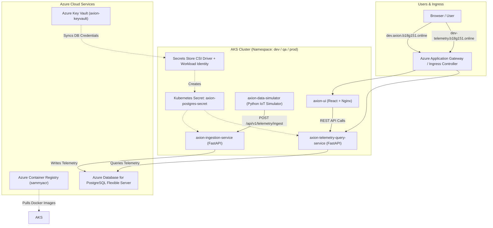

# 🚀 Axion on AKS: Complete End-to-End Setup & Deployment Guide

Welcome to the **Axion Condition Monitoring Platform** deployment guide. This document provides a step-by-step playbook to recreate, configure, build, and deploy this complete enterprise-grade microservices project onto **Azure Kubernetes Service (AKS)** using **Helm** and **Azure DevOps Pipelines**.

---

## 🏗️ 1. Architecture Overview

The Axion Platform is a distributed IoT condition monitoring and refinery analytics system consisting of 4 core microservices, PostgreSQL, Azure Key Vault, and Application Gateway.



### Microservices Summary
| Service | Technology | Port | Purpose |
| :--- | :--- | :--- | :--- |
| **`axion-ui`** | React 18, TypeScript, Vite, Nginx | `80` | Frontend dashboard for condition monitoring, asset telemetry & trends. |
| **`axion-telemetry-query-service`** | Python 3.12, FastAPI, asyncpg | `8000` | REST API providing summary, trends, anomalous devices, and device stats. |
| **`axion-ingestion-service`** | Python 3.12, FastAPI, asyncpg | `8000` | High-throughput ingestion API receiving sensor telemetry payloads. |
| **`axion-data-simulator`** | Python 3.12, requests | N/A | Background daemon generating realistic telemetry data across 27 refinery devices. |
| **`axion-database-schema`** | PostgreSQL SQL scripts | `5432` | Schema definition, TimescaleDB/extensions, and table structures. |

---

## 📋 2. Prerequisites & Tools Required

Ensure the following tools are installed on your workstation:
1. **Azure CLI (`az`)**: Version >= 2.50.0 ([Install Guide](https://learn.microsoft.com/en-us/cli/azure/install-azure-cli))
2. **Kubectl**: Version >= 1.28 ([Install Guide](https://kubernetes.io/docs/tasks/tools/))
3. **Helm**: Version >= 3.11 ([Install Guide](https://helm.sh/docs/intro/install/))
4. **Git**: Version >= 2.40
5. **Azure Subscription**: Contributor / Owner access to create RG, AKS, ACR, and Key Vault.
6. **Azure DevOps Organization**: With permissions to create Service Connections and Pipelines.

---

## ☁️ 3. Azure Infrastructure Setup (Step-by-Step)

### Step 3.1: Define Variables & Resource Group
Open PowerShell or Bash and set your project parameters:

```bash
RESOURCE_GROUP="sammy-rg"
LOCATION="japaneast"
ACR_NAME="sammyacr"
AKS_CLUSTER="sammy-aks"
KEYVAULT_NAME="axion-keyvault"
POSTGRES_SERVER="mypostgresserver"
POSTGRES_DB="postgresdb"
DB_USER="axion_admin"
DB_PASS="SecurePassword123!"
```

Create the resource group:
```bash
az group create --name $RESOURCE_GROUP --location $LOCATION
```

---

### Step 3.2: Create Azure Container Registry (ACR)
```bash
az acr create \
  --resource-group $RESOURCE_GROUP \
  --name $ACR_NAME \
  --sku Standard \
  --admin-enabled true
```

---

### Step 3.3: Create Azure Key Vault & Store Secrets
1. Create the Key Vault:
   ```bash
   az keyvault create \
     --name $KEYVAULT_NAME \
     --resource-group $RESOURCE_GROUP \
     --location $LOCATION \
     --enable-rbac-authorization false
   ```

2. Store Database & Admin Secrets in Key Vault:
   ```bash
   az keyvault secret set --vault-name $KEYVAULT_NAME --name "postgres-username" --value "$DB_USER"
   az keyvault secret set --vault-name $KEYVAULT_NAME --name "postgres-password" --value "$DB_PASS"
   az keyvault secret set --vault-name $KEYVAULT_NAME --name "pgadmin-username" --value "admin@axion.local"
   az keyvault secret set --vault-name $KEYVAULT_NAME --name "pgadmin-password" --value "AdminPass123!"
   ```

---

### Step 3.4: Create Azure Database for PostgreSQL Flexible Server
```bash
az postgres flexible-server create \
  --resource-group $RESOURCE_GROUP \
  --name $POSTGRES_SERVER \
  --location $LOCATION \
  --admin-user $DB_USER \
  --admin-password $DB_PASS \
  --sku-name Standard_B1ms \
  --tier Burstable \
  --version 16 \
  --public-access 0.0.0.0
```
Create the application database:
```bash
az postgres flexible-server db create \
  --resource-group $RESOURCE_GROUP \
  --server-name $POSTGRES_SERVER \
  --database-name $POSTGRES_DB
```

---

### Step 3.5: Create AKS Cluster with Workload Identity & CSI Secrets Store
Enable OIDC Issuer and Workload Identity on AKS for passwordless integration with Azure Key Vault:

```bash
az aks create \
  --resource-group $RESOURCE_GROUP \
  --name $AKS_CLUSTER \
  --node-count 2 \
  --node-vm-size Standard_D2s_v3 \
  --enable-oidc-issuer \
  --enable-workload-identity \
  --enable-addons azure-keyvault-secrets-provider \
  --attach-acr $ACR_NAME \
  --generate-ssh-keys
```

Get Kubernetes credentials:
```bash
az aks get-credentials --resource-group $RESOURCE_GROUP --name $AKS_CLUSTER --overwrite-existing
```

---

### Step 3.6: Configure Azure Workload Identity & Key Vault Access
1. Create a User-Assigned Managed Identity:
   ```bash
   az identity create --name "axion-workload-identity" --resource-group $RESOURCE_GROUP
   
   USER_CLIENT_ID=$(az identity show --name "axion-workload-identity" --resource-group $RESOURCE_GROUP --query 'clientId' -o tsv)
   TENANT_ID=$(az account show --query 'tenantId' -o tsv)
   OIDC_ISSUER=$(az aks show --name $AKS_CLUSTER --resource-group $RESOURCE_GROUP --query "oidcIssuerProfile.issuerUrl" -o tsv)
   ```

2. Grant Managed Identity permission to read Key Vault secrets:
   ```bash
   az keyvault set-policy \
     --name $KEYVAULT_NAME \
     --spn $USER_CLIENT_ID \
     --secret-permissions get list
   ```

3. Create Federated Identity Credentials for target namespaces (`dev`, `qa`, `default`):
   ```bash
   # For dev namespace
   az identity federated-credential create \
     --name "axion-dev-federated-cred" \
     --identity-name "axion-workload-identity" \
     --resource-group $RESOURCE_GROUP \
     --issuer "$OIDC_ISSUER" \
     --subject "system:serviceaccount:dev:axion-keyvault-sa"
   ```

---

## 🗄️ 4. Initialize Database Schema

Connect to your PostgreSQL Flexible Server (via pgAdmin or `psql`) and execute the SQL scripts in [axion-database-schema](file:///E:/Batch%2017/Complete%20Axion%20on%20AKS%20with%20Helm/Axion%20App/axion-database-schema):

1. **`01-extensions.sql`**: Enables UUID and vector/crypto extensions.
2. **`02-telemetry.sql`**: Creates the `telemetry` table and primary indexes on `(timestamp, device_id)`.
3. *(Optional)* **`50 dummy insert.sql`**: Seeds baseline records if you wish to verify queries immediately.

---

## 📦 5. Helm Chart Architecture (`helm/axion-app`)

The unified Helm chart deploys the entire application stack across environments (`dev`, `qa`, `prod`).

```
helm/axion-app/
├── Chart.yaml                     # Metadata (name, version 1.0.0)
├── values.yaml                    # Base values (sammyacr.azurecr.io, resources, ports)
├── values-dev.yaml                # DEV environment overrides (ingress hosts, replicas)
├── values-qa.yaml                 # QA environment overrides
├── values-prod.yaml               # PROD environment overrides
└── templates/
    ├── _helpers.tpl               # Template labels & naming helpers
    ├── serviceaccount.yaml        # KeyVault ServiceAccount with Workload Identity annotation
    ├── secretproviderclass.yaml   # SecretProviderClass syncing secrets to k8s
    ├── ui/                        # Deployment, Service, Ingress for axion-ui
    ├── telemetry/                 # Deployment, Service, HPA, Ingress for query service
    ├── ingestion/                 # Deployment, Service for ingestion service
    └── simulator/                 # Deployment, Service for simulator
```

### Essential Settings in `values.yaml`:
Ensure `global.azure` contains the IDs created in Step 3:
```yaml
global:
  environment: "dev"
  imagePullPolicy: IfNotPresent
  azure:
    enabled: true
    workloadIdentityClientId: "464ac980-6fe4-4683-b10c-8db43119ab0b" # $managedidentity_CLIENT_ID
    tenantId: "d6f408de-8aca-4071-9f35-c11c8f36556c"                 # $TENANT_ID
    keyvaultName: "axion-keyvault"                                   # $KEYVAULT_NAME

postgres:
  host: "mypostgresserver.postgres.database.azure.com"
  port: 5432
  database: "postgresdb"
```

---

## ⚙️ 6. Azure DevOps CI/CD Pipeline Configuration

### Step 6.1: Service Connections
In **Azure DevOps Project Settings > Service Connections**, create two connections:
1. **Docker Registry Connection (`sc-acr-dev`)**:
   - Connection Type: **Azure Container Registry**
   - Registry: `sammyacr`
2. **Kubernetes Service Connection (`aksserviceconnection`)**:
   - Connection Type: **Azure Kubernetes Service**
   - Cluster: `sammy-aks`
   - Namespace: `default` (or leave blank to control via YAML)

### Step 6.2: Pipeline Highlights (`azure-pipelines.yml`)
The pipeline automated workflow has two stages:

1. **Stage 1: BuildAndPush**
   - Disables Docker BuildKit (`DOCKER_BUILDKIT: '0'`) and sets Docker MTU to `1400` to prevent network packet drops during `pip install`.
   - Builds selected images (or `all`) using `--network=host`.
   - Runs **Trivy Vulnerability Scans** (with `continueOnError: true` to prevent blocking on baseline OS CVEs).
   - Pushes built images to ACR tagged with `$(Build.BuildId)` and `<env>-$(Build.BuildId)`.

2. **Stage 2: deploytodev**
   - Deploys via `HelmDeploy@0` using `values-dev.yaml`.
   - Injects the dynamic build tag and repository into all 4 services:
     ```yaml
     overrideValues: |
       ui.image.repository=$(acrLoginServer)/axion-ui
       ui.image.tag=$(Build.BuildId)
       telemetry.image.repository=$(acrLoginServer)/axion-telemetry-query-service
       telemetry.image.tag=$(Build.BuildId)
       ingestion.image.repository=$(acrLoginServer)/axion-ingestion-service
       ingestion.image.tag=$(Build.BuildId)
       simulator.image.repository=$(acrLoginServer)/axion-data-simulator
       simulator.image.tag=$(Build.BuildId)
     ```

---

## ⚠️ 7. Critical Lessons Learned & Troubleshooting Checklist (Must Read!)

When setting up or maintaining this repo, keep these 5 hard-earned solutions in mind:

### 1. Docker Build MTU Drop in Azure Pipelines (`ReadTimeoutError`)
> [!WARNING]
> On Azure DevOps hosted agents (`ubuntu-latest`), Docker's default bridge network MTU is `1500`, but Azure's virtual network MTU is `1400–1450`.
* **Symptom**: `pip install` hangs for 15s and fails with `ReadTimeoutError: HTTPSConnectionPool(host='pypi.org'): Read timed out`.
* **Fix**:
  1. Add `DOCKER_BUILDKIT: '0'` to Azure Pipeline variables.
  2. Configure `/etc/docker/daemon.json` with `{"mtu": 1400, "dns": ["8.8.8.8", "1.1.1.1"]}` and restart Docker before building.
  3. Pass `arguments: '--network=host'` to the `Docker@2` build tasks.
  4. Use `--default-timeout=120 --retries=5` in the Python Dockerfiles.

---

### 2. ACR Registry Typo (`sammycr` vs `sammyacr`)
> [!IMPORTANT]
> A single missing character (`sammycr.azurecr.io` instead of `sammyacr.azurecr.io`) will cause Kubernetes pods to fail with `lookup sammycr.azurecr.io ... no such host` and enter `ImagePullBackOff`.
* Always verify that `values.yaml` and pipeline `$(acrLoginServer)` match the exact name created in Azure CLI.

---

### 3. Helm Dynamic Image Tag Injection
> [!TIP]
> If your Helm chart organizes images under service keys (`ui.image.tag`, `telemetry.image.tag`), passing a generic `--set image.tag=$(Build.BuildId)` in HelmDeploy **will be ignored**, causing Helm to fall back to hardcoded tags (e.g. `dev-18`).
* Always pass the fully-qualified keys in `overrideValues`:
  `ui.image.tag=$(Build.BuildId)`, `telemetry.image.tag=$(Build.BuildId)`, etc.

---

### 4. Helm Stuck in `pending-upgrade` State
> [!CAUTION]
> If a pipeline job times out or is cancelled while Helm is running, Helm locks the release in `pending-upgrade`. Any subsequent pipeline run will fail immediately with:
> `Error: UPGRADE FAILED: another operation (install/upgrade/rollback) is in progress`
* **Fix**: Clear the release lock using kubectl or helm:
  ```powershell
  # Uninstall the stuck release so Helm can perform a clean fresh install:
  helm uninstall axionui-dev-release -n dev
  ```

---

### 5. Frontend API_BASE Protocol (`http://` prefix)
> [!IMPORTANT]
> In React / Single Page Applications (like `DashboardView.tsx`), API endpoints must always include the protocol:
> ```typescript
> // ❌ WRONG (Browser treats this as a relative URL on current domain):
> const API_BASE = 'dev-telemetry.b18g151.online';
> 
> // ✅ CORRECT (Full absolute URL):
> const API_BASE = 'http://dev-telemetry.b18g151.online';
> ```

---

## 🚦 8. Quick Verification Commands

Once deployed, verify your cluster status using PowerShell:

```powershell
# 1. Verify all 4 microservices are Running
kubectl get pods -n dev

# 2. Check simulator is pushing telemetry
kubectl logs -l app=axion-data-simulator -n dev --tail=20

# 3. Check ingestion service is receiving payloads
kubectl logs -l app=axion-ingestion-pod -n dev --tail=20

# 4. Check telemetry query service is responding
kubectl logs -l app=axion-telemetry-query-service-pod -n dev --tail=20

# 5. Access the Frontend UI
# Open your browser and navigate to:
# http://dev.axion.b18g151.online
```
